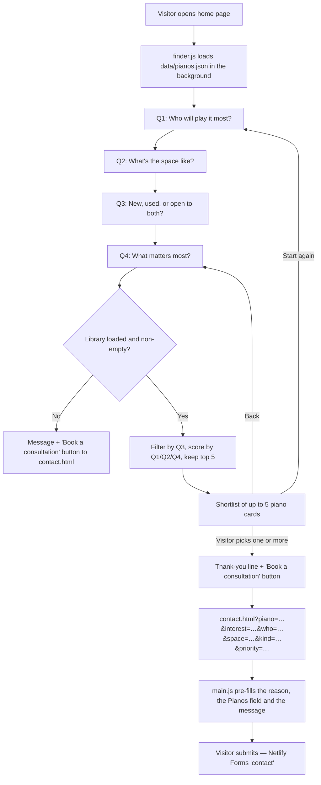

# Best-fit finder — how it works

The best-fit finder is the four-question wizard on the home page
(`index.html#finder`). It asks visitors about their needs, picks up to five
pianos from the site's piano library, lets them choose one or more, and hands
them to the contact form with everything pre-filled. It runs entirely in the
browser; there is no backend beyond Netlify Forms at the very end.

## The flow at a glance



## 1. Where the pianos come from

| Step | Where |
| --- | --- |
| Editors add or edit pianos in **/admin → Pianos** | `admin/config.yml` (collection `pianos`) |
| Each piano is saved as a Markdown file | `content/pianos/*.md` |
| The Netlify build (`npm run build`) turns them into one JSON file | `build/generate.mjs` → `buildPianosData()` |
| The finder downloads that file when the page loads | `data/pianos.json`, fetched by `js/finder.js` |

Every piano in `content/pianos` is in the finder's library, except any with `status: draft`. The fields the
finder uses are:

| Field in /admin | JSON key | Used for |
| --- | --- | --- |
| Category (New / Used / Restored / Pre-owned) | `category` | Filtering on Q3 (a new digital piano also appears for "New instruments") |
| Self-playing capable | `self_playing` | Filtering on Q3 ("Self-playing capable") |
| Type (Grand, Baby Grand, Upright, Digital, …) | `type` | Filtering on Q3 ("Digital piano") and score adjustments for room size and player |
| Finder — suits which players | `fits_who` | Scoring on Q1 |
| Finder — suits which spaces | `fits_space` | Scoring on Q2 |
| Finder — strengths | `priority` | Scoring on Q4 |
| Title, maker, size, price, excerpt, main photo | `title`, `constructor`, `size`, `price`, `excerpt`, `image` | What the result card shows |

**A piano with none of the three "Finder —" fields ticked can still appear,
but it will rarely rank highly.** Tick them for every piano you want the
finder to recommend.

## 2. The four questions

Each answer is a button with a `data-value`. Clicking one highlights it and,
after a short pause (160 ms), moves to the next question. The four dots in the
top-right show progress; **Back** returns to the previous question.

| # | Question | Answers (`data-value`) |
| --- | --- | --- |
| Q1 `who` | Who will play it most? | `beginner` · `hobby` · `advanced` · `venue` |
| Q2 `space` | What's the space like? | `apartment` · `livingroom` · `large` · `public` |
| Q3 `kind` | New, used, or open to both? | `new` · `used` · `either` · `selfplay` · `digital` |
| Q4 `priority` | What matters most? | `value` · `tone` · `design` · `longevity` |

The wording comes from the `finder.*` keys in `locales/*.json`, so the finder
is translated with the rest of the site.

## 3. How the shortlist is chosen

After Q4, `renderResults()` in `js/finder.js` builds the shortlist.

**Step 1: filter by Q3.**

| Q3 answer | Pianos kept |
| --- | --- |
| New instruments | `category` is `New` |
| Used & pre-owned | `category` is `Used`, `Restored` or `Pre-owned` |
| Self-playing capable | `self_playing` is ticked |
| Digital piano | `type` is `Digital` |
| Open to both | All pianos |

If no piano passes the filter:

- **Used & pre-owned:** no shortlist is shown. Instead the finder explains
  that we source and independently check used pianos, with a **Start a used
  search** button (to the contact form, with "Used & pre-owned search" and
  the four answers filled in) and a link to the Used page (`vintage.html`).
  This matches where the Used menu item leads.
- **Any other answer:** the finder falls back to the **whole library** and
  adds a note that a consultation will refine the list.

**Step 2: score each remaining piano.**

| Rule | Points |
| --- | --- |
| Piano's "suits which players" includes the Q1 answer | +3 |
| Piano's "suits which spaces" includes the Q2 answer | +2 |
| Piano's "strengths" includes the Q4 answer | +2 |
| Q2 is Apartment / small room and the piano is a Grand or Baby Grand | −4 |
| Q2 is Public / performance space and the piano is an Upright | −2 |
| Q2 is Large / open-plan room and the piano is a Grand or Baby Grand | +1 |
| Q1 is A venue or institution and the piano is a Grand or Baby Grand | +1 |
| Q1 is A beginner or child and the piano is an Upright | +1 |

**Step 3: rank.** Pianos are sorted by score, highest first, and the top five
are shown. **Exception:** when Q1 is "A beginner or child", digital pianos
(type `Digital`, i.e. the OLYA) are always placed first, then the rest by
score. Ties keep the library's order: newest `date` first.

## 4. The results screen

- Up to five cards, each showing the photo, maker · size, title, excerpt,
  price and "Choose this piano".
- Clicking a card selects it; clicking again deselects it. **More than one
  piano can be chosen.**
- With nothing chosen, a hint asks the visitor to select a piano or go back.
- With one or more chosen, the hint becomes a thank-you line naming them
  ("Great choice — the …" / "Great shortlist — …") and a **Book a
  consultation** button.
- **Back** returns to Q4 with the earlier answers kept. **Start again** clears
  everything and returns to Q1.

If the piano library couldn't be loaded or is empty (and the visitor didn't
choose Used & pre-owned, which always gets the used-search screen above), the results screen skips
the cards and shows a "Book a consultation" button straight to the contact
page, with no answers attached.

## 5. Handing over to the contact form

The **Book a consultation** button links to `contact.html` with the visitor's
choices in the address, for example:

```
contact.html?piano=feurich-115-premiere,feurich-122-universal&interest=buying-first&who=beginner&space=apartment&kind=new&priority=value
```

| Parameter | Value |
| --- | --- |
| `piano` | Slugs of the chosen pianos, comma-separated |
| `interest` | `used` if Q3 was Used & pre-owned; otherwise `buying-first` if Q1 was A beginner or child; otherwise `buying-upgrade` |
| `who`, `space`, `kind`, `priority` | The four answers |

On the contact page, `js/main.js` then:

1. **Selects "How can we help?"** using `interest` (`initInterestPrefill`).
2. **Fills the read-only "Pianos" field** with the chosen pianos' titles and
   shows it (`initPianoPrefill`), so they arrive with the submission and in
   the notification email.
3. **Writes a starter message**, only if the message box is empty, listing the
   four answers in plain English (from `FINDER_ANSWERS`) followed by "I'm
   interested in the …. Please advise on the best fit for me." On the
   used-search path (no piano chosen) it ends instead with "I'm looking for a
   used piano. Please help me find and check one."

The Used page's "Start a used search", "Commission a used search" and "Book a
consultation" buttons also link to `contact.html?interest=used`, so they
pre-select "Used & pre-owned search" the same way.

The visitor can edit anything before sending. The form posts to Netlify Forms
as the `contact` form.

## Things to know when changing it

- **Adding or renaming an answer** means changing it in four places: the
  button in `index.html`, the options in `admin/config.yml` (for the
  "Finder —" fields), the labels in `FINDER_ANSWERS` in `js/main.js`, and the
  `finder.*` text in `locales/*.json`. Q3 answers also need a rule in
  `kindOk()` in `js/finder.js`.
- **The library loads in the background.** If someone answered all four
  questions before `data/pianos.json` arrived (very slow connection), they
  would see the "no library" fallback rather than a shortlist.
- **`data/pianos.json` is generated.** Edit pianos in /admin or
  `content/pianos/`, not the JSON file; the next build overwrites it.
